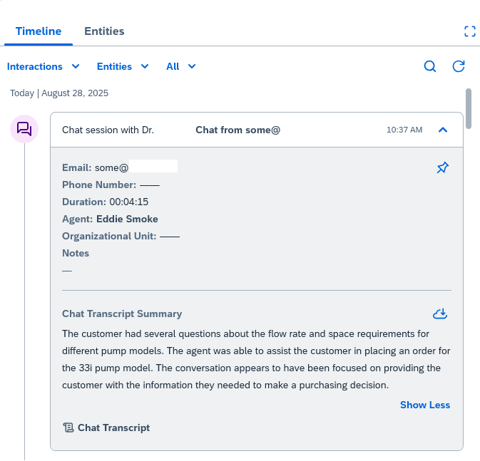

# Amazon Connect Integration with SAP Sales and Service Cloud - GenAI Self-service Chat 

This solution guide provides manual step by step instructions for Amazon Connect Integration with SAP Sales and Service Cloud for GenAI Self-service Chat. This is a continuation of the <a href="../README.md" target="_blank">previous workshop</a>.

*Note: Identify the region where you will be deploying the solution, prior to each resource creation, ensure you are operating and creating resources in the same identified region.* 

## Configuring Amazon Q in Connect

### Creating your Amazon Q in Connect Knowledge Base

1. Navigate to the Amazon S3 console
2. Create a new S3 bucket with unique name
3. Upload the provided sample <[FAQ knowledge articles](../chat/kb)> to the S3 bucket created in the previous step

### Creating your Amazon Q in Connect Assistant

1. Navigate to your Amazon Connect instance by selecting the instance alias from your list of Amazon Connect instances in the AWS Console.
2. In the navigation pane, choose Amazon Q, and then choose **Add domain**.
3. On the Add domain page, choose **Create a new domain**. In the Domain name box, enter a friendly name that's meaningful to you, such as your organization name, for example, AnyCompany.
4. Under Encryption, uncheck box and use the default key or select the check box and choose the existing key if one exists.
5. Finally, select **Add domain**.

### Creating your Knowledge Base Integration

1. On the Amazon Q in Connect page, under your domain you just created choose **Add integration**
2. On the Add integration page, choose Create a new integration, and then select S3 as the source
3. In the Integration name box, assign a friendly name to the integration, one that is meaningful to you
4. Under Connection with S3, select Browse S3 and choose your S3 bucket created in the earlier step
4. Under Encryption, choose an existing KMS key or create a new key
5. Select Next
6. Review your config, and select **Add integration**.

## Configuring Lex with Amazon Q in Connect

### Configuring Generative AI-powered Self-service

We need to configure Amazon Connect to allow the Amazon Connect admin console to access Amazon Lex using the pre-built integration so that users can easily create, edit and continuously improve conversational AI bots powered by Amazon Lex.

#### Enable bot Building in Amazon Connect

1. Navigate to your Amazon Connect instance by selecting the instance alias from your list of Amazon Connect instances in the AWS Console.
2. In the navigation pane, choose Flows, and then go to Amazon Lex Bots. Select both check boxes **Enable Lex Bot Management in Amazon Connect** and **Enable Bot Analytics and Transcripts in Amazon Connect**
3. Click on **Save** to save the changes.

#### Configuring your Lex bot for Amazon Q in Connect

1. Navigate to the Amazon Connect admin UI using your connect instance access url.
2. On the navigation menu, select Routing, and then Flows. Select the Bots tab.
3. On the Bots tab, click on **Create bot**. Enter a bot name eg. faq-bot and click on **Create**.
4. Within faq-bot, on the Configuration tab, click on Add Language and select English (US).
5. On the Configuration tab, toggle **Amazon Q in Connect Intent** to enable it. Select the Assistant ARN from the earlier step. Click on **Confirm**.
6. Scroll down and select **Edit** under Additional bot configuration.
7. Within faq-bot Advanced configuration, scroll down to the **Fulfillment** step and click on the little arrow to expand the settings. Click on **Advanced options** and go to the **Success response** step. 
8. Ensure the **Next step in conversation** is set to **End conversation**. Apply and save the change, if not set to **End conversation**.
9. **Save** the intent and go back to the bot configuration in Amazon Connect by selecting **Configuration summary**.
10. On the Configuration tab select **Build language** and wait for the bot to complete building, indicated by a green success banner.
11. Within faq-bot menu, on the **Versions** tab, click on **Create versions**, enter a meaningful description and click on **Create**.
12. On the **Alias** tab, click on **Create aliases**, enter an alias name, enter a meaningful description, select **1** under **Choose an existing version** and select the checkbox **Enable for use in flow and flow modules**. Click on **Create**.

#### Configuring your Lex bot for Capturing Customer Data

1. Sign in to the AWS Management Console and open the Amazon Lex V2 Service
2. From Action, choose Import.
3. In Input file, give the bot a name (ex:emailAddress) and then choose the <[.zip file](../chat/lexBots/emailAddress-LexJson.zip)> that contains the JSON files that define the bot.
4. If the .zip file is password protected, enter the password for the .zip file. Password protecting the archive is optional, but it helps protect the contents.
5. Create or enter the IAM role that defines permissions for your bot.
6. Indicate whether your bot is subject to the Children's Online Privacy Protection Act (COPPA). (ex: select No)
7. Provide an idle timeout setting for your bot. If you don't provide a value, the value from the zip file is used. If the .zip file does not contain a timeout setting, Amazon Lex V2 uses the default of 300 seconds (five minutes).
8. (Optional) Add tags for your bot.
9. Choose whether to warn about overwriting existing bots with the same name. If you enable warnings, if the bot you are importing would overwrite an existing bot, you receive a warning and the bot is not imported. If you disable warnings, the imported bot replaces the existing bot with the same name.
10. Choose Import.
11. After you start the import, you return to the list of bots. To monitor the progress of the import, use the Import/export history list. When the status of the import is Complete, you can choose the bot from the list of bots to modify or build the bot.
12. Click on the bot, view languages, click on English, build the bot and test it
13. Create a bot version (Optional - https://docs.aws.amazon.com/connect/latest/adminguide/amazon-lex.html#lex-bot-create-bot-version)
14. Create an alias for the bot (Optional - https://docs.aws.amazon.com/connect/latest/adminguide/amazon-lex.html#lex-bot-create-alias)
15. Repeat steps 1-14 to import the second bot i.e. <[Identifier](../chat/lexBots/identifier-LexJson.zip)>

## Configure Amazon Lex bot for Amazon Connect Contact Flow Integration

1. Open the Amazon Connect console.
2. Select the Amazon Connect instance that you want to integrate with your Amazon Lex bot.
4. On the navigation menu, choose Flows.
5. Under Amazon Lex, use the dropdown to select the Region of your Amazon Lex bot, and then select your Amazon Lex bot, e.g. Identifier.
6. Select the Amazon Lex bot alias name from the dropdown (Test/Prod), and then choose + Add Lex Bot. 
7. Repeat the steps for the second bot e.g. emailAddress

## Configuring your Contact Flow for Amazon Q in Connect Self-Service

1. Go to Amazon Connect Dashboard, on the navigation menu, select Routing, and then Flows.
2. Create a new inbound contact flow to integrate Amazon Q in Connect.
3. Select the down arrow next to the Save button and select Import (beta).
4. Download and import file <[Contact Flow JSON file](../contact-flow/2-ChatFlow-Manual.json)>.
5. Amazon Q Connect
    - In the flow, configure Flow block Amazon Q Connect. Enter a Flow block name eg. Q in Connect FAQ Assistant, tick the checkbox Set manually and select your Assistant. Click Save.
6. Find the Set working queue block and edit the block, select the dropdown Search for queue and select BasicQueue.
7. Get customer input
    - Configure Flow block Get customer input. Enter a Flow block name eg. Chat Bot, Select Amazon Lex, under Lex bot select the Lex bot **faq-bot** and alias, under Customer prompt Text-to-speech or chat text under eg. "How can I help you with today?"
    - Configure Flow block Get customer input. Enter a Flow block name eg. Email Address Collection, Select Amazon Lex, under Lex bot select the Lex bot **email-address** and alias, under Customer prompt Text-to-speech or chat text under eg. "please enter your email address?"
    - Configure Flow block Get customer input. Enter a Flow block name eg. Identifier, Select Amazon Lex, under Lex bot select the Lex bot **identifier** and alias, under Customer prompt Text-to-speech or chat text under eg. "Okay, $.Customer.FirstName.  Tell me either your customer number, or product serial number." 
8. Inspect the Contact Flow for Set Contact Attributes blocks through out, the following contact attributes are used in the integration.
    - Channel, CHAT
    - Email, email address
    - CustomerUUID, optional custom field
    - TicketID, optional custom field
    - Serial, optional custom field
9. Save and Publish the Contact Flow.

## Configuring your Communication Widget for Chat

1. On the navigation menu, select **Channels**, and then **Communication Widgets**.
2. Create a new communication widget, select **Add widget**.
3. Enter a name for your widget, optionally provide a description.
4. In the **Communication options** section, choose how your customers can engage with your widget.
5. Choose 'Add Chat'. Enable message receipts by selecting **Allow message receipts**.
6. In the drop-down below **Chat contact flow**, select the contact flow created in the earlier step for your chat experience (eg: faq).
7. Select **Save and continue**.
8. In the **Customize widget** screen, select **Save and continue**
9. Navigate to the **Domain & Security** section: 
    - Under the **Add the required domains for the communication widget** paste the CloudFront URL ex: https://dXXXXXX.cloudfront.net
    - Under the **Add security for new communication widget requests**, Choose **No - I will skip**, we can enable this option later, when you configure the widget in your website. It's recommended to utilize this for better security. 
10. Copy the Chat Widget Script and store in a separate text editor will be used to update the sample customer website.
11. Select **Save and continue**.

## Update your Website with the Chat Widget Script

1. Open the file <[CustomerSite1.html](../connector-app/testPage/CustomerSite1.html)> file in your favorite editor to update
1. Identify the 'script block' in the CustomerSite1.html at the end of the <body> and replace it with the chat widget script snippet stored in the previous step.
1. Save changes. 
1. Navigate to your AWS Console and search for S3. Click on S3 to navigate to the AWS S3 Console.
2. From the list of buckets select the S3 bucket created as part of the website deployment
3. Upload the updated file to the S3 in 'testPage' folder. In the testPage/images folder upload <[pump2.png](../connector-app/testPage/images/pump2.png)>
8. In AWS Console, navigate to CloudFront, find the distribution and click on invalidations. Create invalidation and for path add **/***. Navigate to the cloudfront url <https://dXXXXXXXX.cloudfront.net/testPage/CustomerSite1.html> to verify the chat widget in the page.

## Configure Contact Lens Rules 

1. Go to your Amazon Connect Dashboard, from the left navigation, select **Analytics and Optimization** -> **Rules**
3. Select **Create a rule**, select **Conversational analytics**
4. Under the **When** dropdown, choose **Contact Lens post-chat analysis is available**
5. Select `**Any** conditions are met`. Add any condition that will meet your requirements, example: add condition, select **Queues**, `match **Any** of the following **BasicQueue**`.  Select **Next**.
6. Give the rule a name like **SAPPostChatAnalytics** which you will later use. Select **Add action**, and select **Generate an EventBridge event**, enter **SAPPostChatAnalytics** as the Action name.
7. Select **Next**, then **Save and publish**.

## Setup Amazon EventBridge for Chat

Setup Amazon EventBridge to process contact events from Amazon Connect to post chat summary in SAP Service Cloud

1. In AWS Console, search and select **Amazon EventBridge**
2. Select **Rules** on the left under **Buses**
3. Select **Create rule**
4. Under **Name**, enter `Connect-poc-chat-CL-eventbridge-rule`. Select **Next**
5. **Event Source** keep default **AWS events or EventBridge partner events**
6. In **Creation Method** keep the default **Use pattern form**
   * Event source: **AWS services**
   * AWS service: **Amazon Connect**
   * Event type: **Contact Lens Post Chat Rules Matched**
   * Select **Next**
8. In **Target types**, keep the **AWS service** selected, for **Select a target**, select **Lambda function**
8. For **Target Location** select **Target in this account**
9. For **Function** select the previously created Lambda function (ex: poc-lambda-process-contact-lens-event or connector_lambda_function-poc)
10. Select **Next** until you reach the end and select **Create rule** to finish the setup

## Validation
1. Ensure you are signed in to the SAP Sales and Service cloud and also into the Amazon Connect widget on the page. 
1. Go to test page: https://dxxxxxx.cloudfront.net/testPage/CustomerSite1.html
1. Click on the Chat icon on the bottom right of the page
1. Chat flow:
   * Wait for chat greeting to complete 
   * Bot: "Welcome to EcoPump solutions", "How can I help you today?"
   * Post these questions to the bot
   * You: How does flow rate compare between pump 11i and 33i?
   * Bot: The Multi Eco 33i pump has a flow rate of 50 GPM (gallons per minute), while the Multi Eco 11i pump has a flow rate of 20 GPM.
   * You: What are the space requirements for 33i?
   * Bot: The space requirements for the Multi Eco 33i pump are as follows:
   Dimensions: The pump measures 10 inches in length, 6 inches in width, and 8 inches in height.
   Therefore, you need to ensure that you have at least 10 inches by 6 inches by 8 inches of space to accommodate the Multi Eco 33i pump.
   * You: Chat with agent
   * Bot: Certainly! Let me transfer you to a human contact center agent who can assist you further.
   * Bot: Before we get you in touch with a specialist, let's get some information about you.
   * Bot: please enter your email address?
    * You: Provide your email address
   * Bot: Okay, Tell me either your customer number, or product serial number.
   * You: Serial number is XXXXX
   * Agent: Agent accepts the chat in the Amazon Connect widget
   * Agent: Hi, how can I help you
   * You: I want to place order for pump 33i
   * Agent: I will be happy to help you with that, let me place that order for you
   * Agent: I have placed the order, is there anything else to help you
   * You: Thank you, I am good. 
   * Agent: Thanks and have a good day
   * You: End CHAT
1. After the Chat has ended, the agent can see Chat Transcript Summary and also link to the Chat Transcript

<kbd></kbd>
